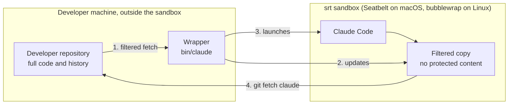
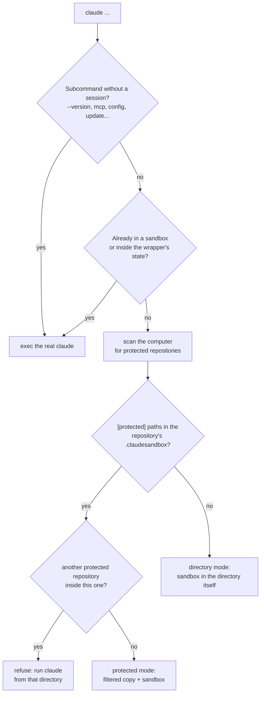
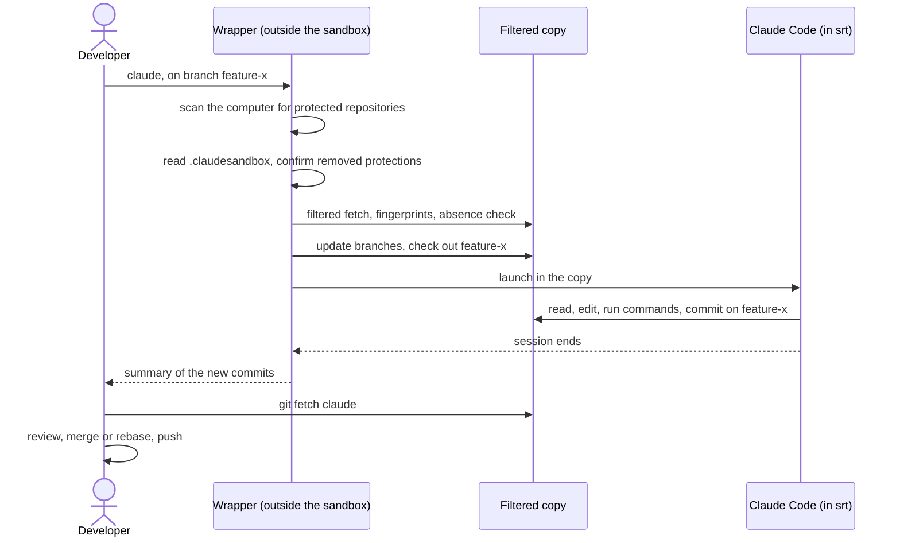
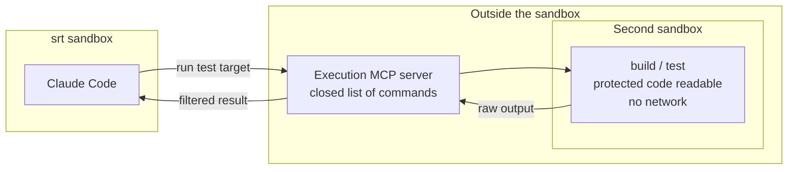

# claude-secure-sandbox: architecture

claude-secure-sandbox lets developers use Claude Code on repositories that contain code Claude must never read. Sensitive paths are listed in a `.claudesandbox` file; Claude works in a copy of the repository from which their content has been removed, in files and in git history alike, inside an OS sandbox that hides every other protected repository of the machine, and the credentials and temp files that could lead to protected code. Claude still uses git normally, and the developer fetches its work with `git fetch claude`.

This document explains how it works, the security model, and why it is built this way. The [README](../README.md) covers installation and usage.

## Contents

1. [Goal and scope](#1-goal-and-scope)
2. [Why existing setups fall short](#2-why-existing-setups-fall-short)
3. [Overview](#3-overview)
4. [Interception and session modes](#4-interception-and-session-modes)
5. [The `.claudesandbox` file](#5-the-claudesandbox-file)
6. [The filtered copy](#6-the-filtered-copy)
7. [The sandbox](#7-the-sandbox)
8. [Session lifecycle](#8-session-lifecycle)
9. [Retrieving Claude's work](#9-retrieving-claudes-work)
10. [Configuration](#10-configuration)
11. [Security model](#11-security-model)
12. [Code execution (planned)](#12-code-execution-planned)
13. [Technical choices](#13-technical-choices)
14. [Limits and troubleshooting](#14-limits-and-troubleshooting)
15. [Roadmap](#15-roadmap)
16. [On-disk layout](#16-on-disk-layout)
17. [Code layout and tests](#17-code-layout-and-tests)

## 1. Goal and scope

Protected code is tracked by git and present in its history: that is the normal case, not an accident to clean up. The tool must hold even if Claude is manipulated by a prompt injection (malicious text in a file, an issue, a web page) and actively tries to reach that code.

**Guaranteed**

- The content of protected paths is unreadable from the sandbox, whatever the tool: file reads, shell, scripts, git, network. That includes past versions, and identical content at other paths.
- In every session, protected repository or not, Claude can read the rest of the computer except a denylist, and writes only to its working directory and its temp directory. The denylist holds every other protected repository found on the local disks at launch, entirely, wherever it is; old Claude transcripts; and, when protected code exists on the computer, the credentials that open git servers (SSH keys, keychain, tokens) and the temp directories.
- No process started by Claude can get a program outside the sandbox to run something for it (launchd, cron, other applications, sockets, files run later by the developer's tools).
- The network is limited to an allowlist of domains, with no git host.
- A path removed from `.claudesandbox` stays protected until the developer confirms the removal, outside the sandbox.

**Out of scope**

- Stopping a developer from bypassing the tool (`claude-unsandboxed`) or pasting code into the conversation: that is the job of MDM and internal policy.
- Hiding the names of protected files, their sizes and commit messages.
- Inference from visible code (callers, tests, interfaces).
- Kernel or `srt` vulnerabilities (`srt` is a research preview).
- Windows, submodules and git worktrees (v1).

## 2. Why existing setups fall short

- **An instruction in the prompt or in `CLAUDE.md`** ("do not read `core/`") is not deterministic. Claude can lose track of it in a long session, or be steered by a prompt injection.
- **Claude Code's permission rules and built-in sandbox** are enforced, but tool by tool and path by path. A rule that blocks reading `core/` with one tool does not cover another tool, a script, or `git show` on an old commit.
- **A Docker container or devcontainer** isolates the whole process tree, but mounting the repository mounts its `.git`, with the full history.

| Approach | Enforced by | Protected files on disk | Protected content in git history | Claude can commit |
| --- | --- | --- | --- | --- |
| Instruction in the prompt or `CLAUDE.md` | the model, not deterministic | readable | readable | yes |
| Claude Code permission rules and built-in sandbox | Claude Code, tool by tool | blocked for the configured tools | readable through `.git`, unless `.git` is blocked too | only if `.git` stays readable, which leaks history |
| Docker container or devcontainer | the container | depends on the mount | readable if `.git` is mounted | only if `.git` is mounted, which leaks history |
| claude-secure-sandbox | the OS kernel, for every process Claude starts | absent | absent | yes, fetched with `git fetch` |

Every protected file lives on in `.git`: in packfiles, in `git log -p`, in `git show <old-commit>:path`. Hiding the working tree is not enough, and blocking `.git` takes git away from Claude. claude-secure-sandbox removes that trade-off.

## 3. Overview



1. **Filtered copy.** At launch, the wrapper fetches the developer's repository into a copy, without the protected content, and puts it on the developer's current branch. In history, a hidden content appears as one line: `[claude-secure-sandbox] hidden by .claudesandbox`.
2. **Sandboxed session.** Claude Code runs inside `srt`, in the copy. It can read the rest of the computer except a denylist: the developer's repository, every other protected repository, credentials, temp directories and old Claude transcripts. It writes only to the copy and its temp directory.
3. **Retrieval.** The developer's repository has a `claude` remote that points to the copy: `git fetch claude` brings Claude's branches as `claude/<branch>`.
4. **Integration.** The developer reviews, merges or rebases, and pushes. CI builds and tests with the full code.

| Component | Role |
| --- | --- |
| Wrapper `bin/claude` (Python 3.9+, standard library only) | Intercepts the `claude` command, prepares the copy and the sandbox, asks the developer when a decision is theirs. Placed before the real binary on the `PATH`; the real binary stays available as `claude-unsandboxed`. |
| `srt` (`@anthropic-ai/sandbox-runtime` 0.0.78, pinned) | Confines Claude's whole process tree: tools, shell, local MCP servers, hooks. On macOS, a kernel Seatbelt profile; on Linux, bubblewrap namespaces with a seccomp filter. Both are generated from the same settings file. |
| Filtered copy (`~/.cache/claude-secure-sandbox/<repo>-<hash>/work`) | Claude's workspace, with its own `.git`: same commits and SHAs as the developer's repository, without protected content. |
| `libexec/git-remote-csnull` | Promisor remote of the copy, which serves no object, so git never tries to fetch hidden content. |
| The `claude` remote | Remote of the developer's repository that points to the copy, push disabled. |

The wrapper is the only trusted component that touches both sides. Claude only ever touches the copy, and everything it writes there is treated as untrusted.

### What Claude sees

| | In Claude's copy |
| --- | --- |
| Public files | as in the developer's repository, at the current commit |
| Protected paths | absent from disk |
| Protected content in history | `git log -p`, `git show` and `git blame` show one line instead: `[claude-secure-sandbox] hidden by .claudesandbox` |
| Public files whose content is identical to a protected file (a copy, a file moved out of a protected directory) | absent too, listed once before Claude starts; changing such a file, even by one line, makes the new version visible |
| Names of protected files, their sizes, commit messages | visible |
| The developer's branches | updated at each launch, without the protected content |
| The developer's uncommitted changes, and commits made during the session | not visible until they are committed, and the next launch |

Claude cannot build or test what depends on protected code. It builds what it can, and when a task needs a change in a protected path, it describes the change for the developer to make by hand.

## 4. Interception and session modes

The wrapper is a script named `claude`, placed before the real Claude Code binary on the `PATH`. The developer keeps typing `claude`.



Every session runs in the sandbox, in one of two modes:

| | Protected mode | Directory mode |
| --- | --- | --- |
| When | `[protected]` paths in `.claudesandbox` at the repository root, now or in its history | anywhere else |
| Claude works in | the filtered copy | the repository root, or the current directory outside a repository, directly |
| Readable | the rest of the computer, except the developer's repository and the denylist (section 7) | the rest of the computer, except the denylist (section 7) |
| Writable | the copy and the session's temp directory | the directory and the session's temp directory; only the temp directory when the directory holds the home directory |
| Writable in `.git` | everything except configuration, hooks and object store metadata | the same |
| Retrieval | `git fetch claude` | nothing to retrieve: Claude commits in the directory |

In both modes every other protected repository of the computer is hidden entirely, not readable and not writable, including one below the directory the session was started in (section 7).

- **Finding the real binary.** The first `claude` on the `PATH` that is not the wrapper itself (symlinks resolved).
- **Subcommands without a session** run unchanged: `-v`, `--version`, `-h`, `--help`, `update`, `doctor`, `mcp`, `config`, `plugin`, `setup-token`, `install`, `migrate-installer`.
- **Nested sandboxes.** Inside a sandbox the wrapper sets `CLAUDE_SECURE_SANDBOX_ACTIVE=1`; a `claude` started from there runs the real binary, already confined.
- **Machine scan.** At each launch, before the session and in both modes, the wrapper looks for every directory that holds a `.claudesandbox` with `[protected]` paths, or an earlier `.claudeprotected` (`scan.py`); a file it cannot read counts as protected. The roots are `/`, the home directory and every other local disk (macOS: the entries of `/Volumes`; Linux: the mount points of local filesystems in `/proc/mounts`: ext2/3/4, xfs, btrfs, zfs, f2fs, jfs, reiserfs, vfat, exfat, ntfs, ntfs3, fuseblk). Each root is scanned without leaving its filesystem (`fd --one-file-system`, else `rg --one-file-system`, else `find -xdev`), skipping `.git`, `node_modules` and the wrapper's state, whose copies hold a `.claudesandbox` too. It takes about 6 s on the author's Mac; in a terminal the wrapper prints `looking for protected repositories on this computer...` meanwhile. The repositories the wrapper was used in before (`state/repository` in each repository's state) are added, in case they sit where the scan cannot go. There is no cache and no background scan: a repository cloned a minute ago is hidden at the next launch. `CLAUDE_SECURE_SANDBOX_SCAN=limited` limits the scan to the home directory and the session's directory (the tests use it).
- **Other protected repositories** found by the scan are hidden entirely (section 7). The only refusal left is a protected repository nested inside the current protected repository: `protected code in <path>, inside this repository: run claude from that directory`. Claude works in the filtered copy, which would hold that repository's files.
- **Home directory.** Started in a directory that holds the home directory (`~`, `/Users` or `/home`, `/`) or other disks, a directory-mode session can read it, except the denylist. It cannot write there, though: programs outside the sandbox run what lives in the home directory (shell startup files, LaunchAgents, tool configurations, `~/.claude`), so Claude writes only to its temp directory and gives the developer the changes to apply. Protected repositories in it stay hidden, and so do old Claude transcripts (`~/.claude/projects`, `file-history`, `history.jsonl`...) and the wrapper's state: they may hold protected code read elsewhere. Credentials and temp directories are hidden too when another protected repository was found, and readable when nothing on the computer is protected.
- **Preconditions:** macOS or Linux, `git`, `rg`, `srt` installed by `npm ci`, and on Linux `bwrap` and `socat`. In protected mode, no git worktree. Submodules trigger a warning: their content is missing from the copy. A lock (`state/lock`, with the PID) allows one session per protected repository; a stale lock is taken over. Starting from inside a protected path is refused; from another subdirectory, Claude starts in the same subdirectory of the copy.
- **Directory mode** has no copy, no lock and no end of session summary. `.git/config`, `.git/hooks` and the other locked paths of `.git` are read-only (section 7): the developer's git, outside the sandbox, would otherwise run what Claude writes there. It uses its own system prompt, `share/prompts/directory-mode.md`.

## 5. The `.claudesandbox` file

One file at the repository root, committed, with three sections:

```
# .claudesandbox
[protected]
# a directory: everything below it, at any depth
core/engine/
# a single file
licensing/keys.go

[path]
~/.m2
/opt/android-sdk

[domain]
registry.npmjs.org
*.pythonhosted.org
```

- `[protected]`: paths Claude must never read. A repository with at least one is in protected mode (section 4).
- `[path]`: paths Claude may read beyond the defaults (section 7), read only.
- `[domain]`: network domains Claude may reach beyond the Anthropic domains.

A line outside a section, an unknown section or an invalid entry stops the launch with the list of errors. Lines that start with `#`, and empty lines, are ignored. A `.claudeprotected` from an earlier version stops the launch with the way to convert it (add a `[protected]` line above its paths, and rename it); the scan still treats a directory that holds one as protected.

### `[protected]`

| Rule | Detail |
| --- | --- |
| Literal paths | Relative to the root; a directory protects everything below it. Leading `./`, trailing `/` and repeated `/` are normalized. |
| Refused | Absolute paths, `..`, `.git`, the root itself, `.claudesandbox` itself, patterns (`*`, `?`, `[`, `\`, leading `!`). |
| Source | The file on disk and the version committed at `HEAD`; the union of both applies. |
| Outside git | A directory that is not a git repository cannot have protected paths: the launch stops. |
| Addition | The wrapper keeps a hash of the protected list. When it changes, the copy is rebuilt from scratch and the repository's Claude sessions are archived, since they may have read files that are now protected. |
| Removal | Every version of the file in the history of `HEAD` is read (`git log --full-history -- .claudesandbox`). A path protected by an earlier version and no longer protected stays protected until the developer confirms its removal. A repository that was ever protected stays in protected mode until every removal is confirmed. |

**Why a removal needs a confirmation.** Inside the copy, `.claudesandbox` is write-denied, but that does not stop a commit that changes it: Claude writes the copy's object store, so it can build such a commit with git plumbing (`hash-object`, `update-index`, `commit-tree`) without touching the file on disk. The commit carries the developer's identity and, once merged, looks like any other change. The wrapper therefore asks in the terminal, before Claude starts:

```
claude-secure-sandbox: paths no longer under [protected] in .claudesandbox, Claude would be able to read them:
  core/engine
claude-secure-sandbox: remove their protection? [y/N]
```

Confirmations are kept in `.git/claude-secure-sandbox/unprotected` in the developer's repository, out of the sandbox's reach. A confirmation ends when the path is protected again, so a later removal asks again. Without a terminal (`claude -p` in a script), the path stays protected. Losing the confirmations only means being asked again: it never unprotects anything.

**Making one file of a protected directory public.** Patterns and exceptions are not supported: list the other entries of the directory instead of the directory itself, and confirm the removal. Files added to that directory later are then not protected until they are listed. A file moved out of a protected directory stays hidden by its fingerprint (section 6) until its content changes.

### `[path]` and `[domain]`

What they open is granted only once the developer has confirmed it in the terminal, before Claude starts: Claude can write the file, directly in directory mode, or through a commit the developer merges in protected mode.

```
claude-secure-sandbox: .claudesandbox asks for access Claude does not have by default:
  read /Users/dev/.m2
  domain registry.npmjs.org
claude-secure-sandbox: allow it? [y/N]
```

| Rule | Detail |
| --- | --- |
| Source | The file on disk only, at the repository root (or in the directory, outside a repository). |
| `[path]` | Absolute or `~/...`, literal, read only. Refused: `/`, the home directory itself, `.` and `..`, and any path that overlaps credentials, `~/.claude`, `~/.claude.json`, the temp directories, the wrapper's state, a protected repository, or, in protected mode, the developer's repository and its `.git`. |
| `[domain]` | A name, `*.name` (every name below it) or an address, with an optional `:port`. Refused: `*`, a git host or a name that can match one (`api.github.com`, `*.com`), GitHub's MCP server (`*.githubcopilot.com`), and this computer (`localhost`, `*.localhost`, loopback, unspecified and link-local addresses). |
| Refused entry | Stops the launch before any question. |
| Confirmation | Stored in the wrapper's state (`state/granted`), out of the sandbox's reach. Without a terminal, or when the developer answers no, nothing new is granted for this session and the question comes back at the next launch. |
| End | A confirmation ends when its entry leaves the file: adding it again asks again. |

Keep `[domain]` short: every allowed domain is a place data can be sent to, and a service there that can reach the code host would relay protected code.

## 6. The filtered copy

The copy is a git repository built by the wrapper from the developer's local repository, with the same commits and SHAs but none of the protected contents. The developer's repository is only read, except for the `claude` remote and the confirmations of section 5, both in its local `.git`.

### Steps

1. **Filtered fetch.** The wrapper fetches the developer's branches and `HEAD` into the copy under `refs/incoming/`, and tags that point to a commit under their own name, with a `sparse:oid` partial clone filter. The filter is a sparse specification (`/*`, then `!/<path>` for each protected path), stored in a small repository of the wrapper's state, `state/spec.git`, and made visible to the developer's `upload-pack` through `GIT_ALTERNATE_OBJECT_DIRECTORIES`. Commits and trees are complete; blobs under protected paths are not sent. The fetch is incremental.
2. **Removal by fingerprint.** git filters by path, so a protected content that also exists under a public path (a file moved into a protected directory later, an identical copy, a branch merged with `-s ours`, a commit of Claude's that places a protected blob at a public path) would come through. The wrapper lists every blob that ever existed under a protected path with `git log --raw --full-history --diff-merges=first-parent --root -- <protected paths>` on the developer's repository, and keeps that list in `state/protected-blobs`. Every blob of the copy found in the list is dropped by rewriting the copy's packs with `pack-objects`; the new pack is marked `.promisor`, so git treats missing objects as expected. The empty blob is never hidden, since its content is known.
3. **Absence check.** After every update, the wrapper checks that no blob of the list is present in the copy. If the check fails, the copy is rebuilt from scratch; if it fails again, the session is cancelled.
4. **Placeholders.** Each hidden content is replaced, in the copy only, by the one-line blob `[claude-secure-sandbox] hidden by .claudesandbox`, through git replace refs (`refs/replace/<hidden oid>`). `git log -p`, `git show` and `git blame` keep working. If Claude deletes some replace refs, all of them are recreated at the next launch.
5. **Promisor remote that serves nothing.** The copy's promisor remote is `csnull::host`, handled by `libexec/git-remote-csnull`: it lists no branch and answers every fetch with "success, nothing to send". git never fetches a missing content, and diffs do not fail. Only the wrapper's own fetch redirects `csnull::host` to the developer's repository, for that command only.
6. **Branches.** The copy's branches are updated from `refs/incoming/`, which is then deleted (section 8): the developer's branches become plain branches of the copy, under their own names.
7. **Sparse checkout.** Non-cone sparse checkout excludes protected paths, and public files whose content is hidden at the checked-out commit. They are absent from disk: a placeholder on disk could be edited and committed by mistake. At a new session, the wrapper lists the public files absent for that reason, once per file (`state/reported-absent`).

### Copy configuration

| Setting | Value | Why |
| --- | --- | --- |
| `extensions.partialClone` | `host` | Missing blobs are expected, not corruption. |
| `remote.host.url` | `csnull::host` | Served by the null helper. |
| `remote.host.partialclonefilter` | `sparse:oid=<spec>` | Filter applied to every fetch. |
| `core.sparseCheckout`, `core.sparseCheckoutCone` | `true`, `false` | Arbitrary file exclusions. |
| `core.commitGraph`, `gc.auto`, `maintenance.auto` | off | No background rewrite of the object store. |
| `user.name`, `user.email` | copied from the developer's repository | Claude's commits carry the developer's identity. |

### Hardened git for the wrapper

Claude can write to the copy, so every git command the wrapper runs on it ignores what Claude could have planted:

- no hooks (`core.hooksPath=/dev/null`), no fsmonitor, no untracked cache, no commit-graph, no external diff, no pager, no credential helper, no SSH, protocols limited to `file`;
- no global or system configuration, no grafts, no lazy fetch (`GIT_NO_LAZY_FETCH=1`);
- no replace refs for checks (`GIT_NO_REPLACE_OBJECTS=1`), so placeholders never hide what a commit really contains.

At every launch and at the end of each session, the wrapper also checks the structure of the copy's `.git`: no `alternates`, `http-alternates`, `commondir`, `shallow` or `info/grafts`, no symbolic or hard link in `objects/`, and the promisor remote unchanged. A failure rebuilds the copy at the next launch.

### Performance

Only commits that are new since the last launch are fetched and scanned (`state/host-tips`). The first creation scans the whole history: about 20 s to clone and 23 s to remove fingerprints on git/git (85,000 commits), measured with the prototype.

## 7. The sandbox

Claude Code runs as:

```
srt --settings run/srt-settings.json -- \
  /usr/bin/env TMPDIR=tmp/ claude --settings '{"sandbox":{"enabled":false}}' \
  --append-system-prompt-file run/system-prompt.md <developer's arguments>
```

Claude Code's own sandbox is disabled because `srt` already wraps the whole process tree: every tool, shell command, local MCP server and hook started by Claude inherits the same confinement. Claude is launched by the real path of its binary, since a link that goes through a hidden area does not resolve inside the sandbox.

### Reading: a denylist

The principle is the same in every session: Claude can read the whole computer, except a denylist. `srt` reads are allowed everywhere unless denied; the wrapper lists what to hide in `denyRead`.

| Area | Access |
| --- | --- |
| The copy (`work/`), or the directory in directory mode | read and write; read only when the directory holds the home directory (section 4) |
| Session `TMPDIR` (`tmp/`), sandbox Claude configuration (`claude-home/`) | read and write |
| Confirmed `[path]` entries of `.claudesandbox` | read |
| The rest of the computer: system, tools, home directory, other projects, other disks | read |
| In protected mode, the developer's repository and its `.git` | none: Claude works in the copy |
| Every other protected repository: any directory whose `.claudesandbox` has `[protected]` paths, found by the scan at launch or used with the wrapper before (section 4), including one below the session's directory | none, and not writable |
| Old Claude transcripts and history in `~/.claude`: `projects`, `file-history`, `history.jsonl`, `todos`, `shell-snapshots`, `sessions`, `statsig`, `debug`, `ide`, `.credentials.json` | none, in every session |
| The wrapper's state, except `claude-home` and the session's own `run/`, `tmp/` and `work/`; in `claude-home`, the sessions of other repositories | none |
| Credentials, relative to the home directory: `.ssh`, `.gnupg`, `.aws`, `.azure`, `.kube`, `.docker/config.json`, `.netrc`, `.git-credentials`, `.npmrc`, `.pypirc`, `.cargo/credentials.toml`, `.config/gh`, `.config/hub`, `.config/gcloud`, `.password-store`, `Library/Keychains`, `.local/share/keyrings` | none when protected code exists on the computer |
| Temp directories: `/tmp`, `/private/tmp`, `/var/tmp`, and on macOS the per-user temp and cache directories (`getconf DARWIN_USER_TEMP_DIR` and `DARWIN_USER_CACHE_DIR`) | none when protected code exists on the computer |

- **When protected code exists.** Always in protected mode; in directory mode, when the scan found at least one other protected repository. Credentials are hidden then because they open the git servers that host protected code; temp directories, because they may hold copies of it (editor files, build outputs, earlier sessions). When nothing on the computer is protected, both stay readable.
- **What the session needs is re-allowed only where a deny covers it.** The copy, `tmp/`, `run/`, `claude-home/`, `libexec/`, the Claude Code installation, `srt`'s own helpers (`vendor/`, for the seccomp filter on Linux) and the `~/.claude` items passed through are listed in `allowRead` only when they lie inside a hidden area (state or temp directory under `/tmp`, for instance). In `srt`, an allowed read beats a broader deny, and a more specific deny still beats an allow. They are not listed otherwise because on Linux a read-only bind of a directory would cover the writable mounts inside it.
- A Claude Code installation inside a sensitive area (the wrapper's state, `~/.ssh`, `~/.claude`, the repository) is refused, except `~/.claude/local`.
- **xcrun.** On macOS, `/usr/bin/git` is a shim that looks the real binary up through `xcrun` and its cache, in the user's temp directory. The cache is not writable from the sandbox (and hidden when protected code exists): a writable cache would let Claude point `git` at its own program, which the developer would then run outside the sandbox. Since the shim cannot refresh its cache, `run/bin/git` calls the real binary directly, found by `xcrun -f git` outside the sandbox; without it, every `git` call would run `xcodebuild`.
- `filesystem.allow_read` is no longer used: tools in the home directory are readable without it. The wrapper prints a warning when the configuration still has it.

### Writing

Writes are denied everywhere except the copy (or the directory, unless it holds the home directory), `tmp/` and `claude-home/`. Inside those, these stay write-denied:

- the `.git` paths that would let the wrapper or the developer's git run code or read elsewhere: `config`, `config.worktree`, `hooks`, `info`, `objects/info`, `commondir`, `shallow`, `modules`, `worktrees`;
- `.claudesandbox` and the protected paths;
- every other protected repository below the session's directory;
- on macOS, an anchor file in every writable directory (`.claude-secure-sandbox-anchor`), which makes `srt` forbid deleting or renaming the directory. `srt` resolves symlinks in its rules, so a `tmp/` swapped for a link would otherwise open another directory in the next session; the wrapper also checks at launch that none is a link. On Linux, a writable directory is a mount point, which cannot be renamed or removed.

`srt` adds its own write protections everywhere: shell startup files (`.bashrc`, `.zshrc`...), `.gitconfig`, `.gitmodules`, `.vscode`, `.idea`, `.mcp.json`, `.claude/commands` and `.claude/agents`.

### Linux specifics

bubblewrap confines by mounting, which changes a few behaviours compared with Seatbelt:

- **Read denies are empty `tmpfs` mounts.** A read-denied directory (a protected repository, `~/.ssh`, `/tmp`) appears empty and writable inside the sandbox; what is written there vanishes with the session and never reaches the real directory. The escape tests therefore check the real files after the session.
- **A write deny on a path that does not exist yet** is a mount point that bubblewrap creates on the host for the session. A `.git/commondir` stand-in would break git, so the wrapper creates the locked `.git` directories and the protected paths as empty directories beforehand, and denies only paths that exist. A locked `.git` file that is absent at launch (`commondir`, `shallow`, `config.worktree`) is checked after the session: if one appeared, it is renamed aside with a warning, before any git outside the sandbox reads it.
- **`srt`'s stand-ins** for its own protected files (`.bashrc`, `.gitconfig`, `.vscode`...) appear in every writable directory during the session, on the host too, and are removed afterwards. The sandbox's git ignores them (`core.excludesFile` in `run/gitconfig`), so `git add -A` keeps working.
- **Unix sockets** are blocked by a seccomp filter (x86-64 and arm64): D-Bus, X11 and Wayland clipboards, the SSH agent.
- **A detached process** ends with the session, instead of outliving it confined.
- On Ubuntu 24.04 and later, bubblewrap needs `kernel.apparmor_restrict_unprivileged_userns=0` or an AppArmor profile that grants it user namespaces.

### Process tree and escape attempts

The Seatbelt profile is attached to the process by the kernel and inherited by every descendant. Indirect ways of getting a command run outside the sandbox are closed too; each line below is an end-to-end test, which cleans up if the attempt ever succeeds.

| Attempt from inside the sandbox | Result |
| --- | --- |
| child, grandchild, detached process (`nohup`, background job) | same confinement |
| `crontab`, `at` | denied, nothing created |
| macOS: `launchctl submit`, `open`, `osascript` with an Apple Event, clipboard (`pbcopy`) | denied: Apple Events and Launch Services are off (`allowAppleEvents: false`) |
| Linux: `systemd-run --user`, `xdg-open`, the D-Bus session bus | denied: no Unix socket is reachable |
| SSH agent and other Unix sockets | denied |
| TCP to `localhost` | denied: only the `srt` proxy is reachable (`allowLocalBinding: false`) |
| a program running outside the sandbox that acts on request: an MCP server, an `adb` or Docker daemon, a dev server, here a helper that serves a protected file over localhost TCP and a Unix socket | unreachable: directly, through the proxy (by address or by `localhost`) and through its socket; `allowed_domains` refuses this computer (`localhost`, loopback, unspecified and link-local addresses), and `srt` refuses an allowed name that resolves to it |
| macOS: reading or writing another terminal of the developer (`/dev/ttys*`), to catch what is typed there | denied: terminal access is limited to Claude's own terminal |
| writing `~/.zshrc`, a LaunchAgent, an autostart entry, the `xcrun` cache | the real files are never written |
| a detached process after the session | macOS: still confined, it cannot read what the session could not (credentials, here) and loses the network when `srt` exits; Linux: ended with the session |

Claude's interface puts its terminal in raw mode to read keys, and Seatbelt denies terminal control by default. `srt`'s `allowPty` setting allows it on every `/dev/ttys*`, which would also let Claude open the developer's other terminals and read what is typed there (a `sudo` password, for instance). On macOS, when Claude runs in a terminal, the wrapper sets `allowPty` and loads `libexec/srt-own-terminal.mjs` into `srt` (`node --import`): just before `srt` starts `sandbox-exec`, it rewrites that rule to Claude's own terminal only (`(literal "/dev/ttysNNN")`), and refuses to run anything if the rule is not found, for instance after an `srt` upgrade. Injecting keystrokes into the terminal (`TIOCSTI`) stays denied by the kernel. On Linux, bubblewrap does not restrict terminal control.

Two channels remain outside the sandbox's reach by nature: what the developer runs from Claude's commits after merging them (build scripts, `package.json`, CI), which review covers; and escape sequences written to the developer's terminal, which a terminal may use to set the clipboard (OSC 52; in Ghostty, `clipboard-write = ask`). The copy should not be opened in an IDE that runs project tasks or `.envrc` files.

### Keychain and login

`srt` always allows the Mach services of the macOS keychain (`securityd`). With the keychain files readable, a sandboxed process can read keychain items without any prompt, for example git credentials through `git credential-osxkeychain`. Those credentials open the server that hosts the protected code; from the sandbox they could leave through the conversation, through server-side tools such as web search, or through an allowed domain. When protected code exists on the computer, the wrapper hides `~/Library/Keychains` with the other credentials; that is enough to hide the login keychain (verified on macOS). When nothing on the computer is protected, the keychain stays readable.

Claude Code keeps its own login in the keychain on macOS (entry `Claude Code-credentials`), and in `~/.claude/.credentials.json` on Linux. At each launch the wrapper reads that login, and only it, outside the sandbox, and writes it to `claude-home/.credentials.json` (mode 600), where Claude Code falls back when the keychain is unavailable. A newer login already there, refreshed by Claude Code during a session, is kept. Nothing is ever written back to the keychain. Without a login in the keychain, `/login` inside a session stores one in the same file. Claude can read its own token; it can only send it to allowed domains, which is one more reason to keep that list short.

### Separate Claude configuration

Claude Code stores transcripts in `~/.claude/projects/` and file backups in `file-history/`, which can contain protected code read before the wrapper was installed. The wrapper runs Claude with `CLAUDE_CONFIG_DIR=~/.cache/claude-secure-sandbox/claude-home`; in `claude-home`, the sessions of other repositories are unreadable too.

The configuration is passed through, read only. At each launch, each item of the `sync` list (`settings.json`, `CLAUDE.md`, `agents/`, `commands/`, `skills/`, `plugins/` by default) becomes a link in `claude-home` to the original in `~/.claude`, which stays readable from the sandbox (re-allowed if it lies inside a hidden area). Claude Code uses the developer's configuration as it is; Claude's own sandbox is disabled on the command line (`--settings`). Nothing in `~/.claude` is writable: Claude could otherwise add a hook, a skill or an MCP server that the developer's Claude would run outside the sandbox. Items that hold transcripts, history or credentials (`projects`, `file-history`, `history.jsonl`, `todos`, `shell-snapshots`, `sessions`, `.credentials.json`...) are never passed through, even when listed in `sync`, and are hidden from the sandbox; an item whose real path leads into the repository, the wrapper's state or `~/.ssh` is skipped.

`plugins/` is a directory of links rather than one link: Claude Code rewrites `plugins/synced` and `plugins/store` itself when it syncs the plugins of claude.ai (`CLAUDE_CODE_SYNC_PLUGINS`, below). The sandbox keeps its own copy of these two, made from the originals the first time and then kept up to date by Claude Code in the sandbox; every other entry (`marketplaces`, installed plugins) is a read-only link. A plugin written there runs only in the sandbox.

MCP servers live in `~/.claude.json`, which is Claude Code's state rather than configuration: the account, every project's paths, sessions and costs, caches, all rewritten constantly. It is neither passed through nor copied; the wrapper copies only the MCP servers into the sandbox's own `.claude.json`: the global ones, and those registered for this repository (`claude mcp add`, local scope), attached to the directory Claude works in, with the trust given to this repository. It also copies the onboarding already done outside (`hasCompletedOnboarding`, `lastOnboardingVersion`, `theme`), so that Claude Code does not ask again for a theme and a login method. Files the wrapper writes into `claude-home` replace the entry rather than writing through it, files it reads there must be regular files, and its own temp files live in `state/tmp`, out of the sandbox's reach.

### Network

`srt` routes traffic through a filtering proxy. Allowed: the Anthropic domains (`api.anthropic.com`, `claude.ai`, `platform.claude.com`, `console.anthropic.com`, `statsig.anthropic.com`, `mcp-proxy.anthropic.com`) and the domains added in the configuration. Always denied: GitHub, GitLab, Bitbucket, Azure DevOps, Codeberg, SourceForge, and the hosts of the repository's remotes. A configuration that allows one of them, or `*`, is refused, and so is one that allows this computer: `localhost`, `*.localhost`, a loopback, unspecified or link-local address. A service listening there runs outside the sandbox; reached through the proxy, it could read for Claude what the sandbox hides (an MCP server able to run `adb`, for instance). `srt` itself refuses an allowed name whose address is this computer's.

### Environment and git configuration

| Variable | Value | Why |
| --- | --- | --- |
| `CLAUDE_CONFIG_DIR` | `claude-home` | Separate Claude configuration. |
| `GIT_CONFIG_GLOBAL`, `GIT_CONFIG_NOSYSTEM` | `run/gitconfig`, `1` | The developer's global git configuration (credentials, aliases, hooks) is not used. |
| `PATH` | `libexec/` and `run/bin/` prepended | `git-remote-csnull`, and the direct `git` link. |
| `TMPDIR`, `CLAUDE_CODE_TMPDIR` | `tmp/` | Per-repository temp directory. `srt` forces `/tmp/claude`, shared by every sandbox, and Claude Code's own temp root is `/tmp`, which is hidden when protected code exists. |
| `DISABLE_AUTOUPDATER` | `1` | No update from inside the sandbox. |
| `CLAUDE_CODE_SYNC_PLUGINS` | `1` | Loads the plugins and skills synced from claude.ai: Claude Code turns their sync off when it runs with a configuration directory other than `~/.claude`. |
| `CLAUDE_SECURE_SANDBOX_ACTIVE` | `1` | A nested `claude` runs without a new sandbox. |
| `SSH_AUTH_SOCK`, `GIT_ASKPASS`, `SSH_ASKPASS` | unset | No SSH agent and no credential prompt. |

`run/gitconfig` sets the developer's name and email, `commit.gpgsign = false` (no key in the sandbox), `core.attributesFile` to `/dev/null`, and `core.excludesFile` to `/dev/null` (on Linux, to a list of `srt`'s stand-ins), so that the developer's global files under `~/.config/git` are not used.

### Session marker

A sandboxed session shows itself, so that the developer notices when `claude` is not the wrapper. At launch, in a terminal only, the wrapper prints a screen in plain words (`screen.py`), then waits for Enter and erases itself, so that Claude Code takes a clean terminal; Ctrl-C or end of input cancels the session. The screen says:

- why this mode: `This repository is protected: its .claudesandbox lists protected paths.`, `Nothing is protected here: Claude works directly in this folder.`, or `You started Claude in <dir>, which holds your home folder.`;
- in protected mode, `Hidden from Claude: <paths>`, `Claude works on: a copy of this repository, branch <b>` and `Your files: untouched; get Claude's commits with: git fetch claude`; in directory mode, `Claude can edit: <dir>`, or `nothing there; it will tell you the changes to make` in the home directory;
- in every mode, `Claude can read: the rest of your computer, except what follows`, then `Protected, hidden:` with up to three other protected repositories (`~/...`) and `and N more`, and either `Also hidden: your credentials (SSH keys, keychain, tokens), temp files, and your old Claude conversations` or, when nothing on the computer is protected, `Hidden: your old Claude conversations; nothing on this computer is protected`.

Without a terminal (`claude -p` in a script), it starts at once. During the session, Claude Code's status line reads `🔒 sandboxed · protected repository <name> · <branch>` (or `· directory <name>`, and `· directory <path> (read only)` in a directory that holds the home directory), passed with the other settings on Claude Code's command line; it is left out when the developer configured their own status line, in `~/.claude` or in the repository.

### System prompt

The prompt appended to Claude's depends on the mode. In protected mode (`share/prompts/protected-mode.md`) it tells Claude which paths are protected, that their content is absent on purpose, that the placeholder line is not code, that it cannot build what depends on protected code, and how the git workflow works. Both prompts (`share/prompts/directory-mode.md` for directory mode) say what the sandbox makes unreadable, that git hosts are unreachable, and that `.git` configuration and hooks are read-only. Prompts guide Claude but guarantee nothing; only the sandbox does.

## 8. Session lifecycle



### Launch (protected mode)

1. Machine scan for protected repositories (section 4); one nested inside this repository stops the launch.
2. Repository root, `.claudesandbox`, removed protections confirmed or kept (section 5).
3. Lock, then update of the filtered copy (section 6). A warning is printed if the developer has uncommitted work, which Claude will not see.
4. The `claude` remote is added to the developer's repository, or checked (section 9).
5. The copy's branches are updated (below).
6. Access asked by `.claudesandbox` checked and confirmed, configuration and login sync, generation of the gitconfig, the `git` link, the `srt` settings and the system prompt, all outside the writable areas.
7. Start screen, then launch of Claude Code in `srt`, in the copy. Directory mode runs the same steps 1 and 6 to 7 (one `launch()` in `cli.py`), without the copy.

### Branches at a new session

`claude` starts a new session; `claude --continue` and `claude --resume` resume one. At a new session, Claude's uncommitted changes are stashed in the copy (`git stash`, message `claude-secure-sandbox <date>`), then the wrapper compares the developer's current branch with the copy's branch of the same name:

| Situation | What the wrapper does |
| --- | --- |
| The developer's branch contains Claude's commits, as they are or rewritten (merge, rebase, cherry-pick, new signature; rewritten commits are compared by patch with `git rev-list --cherry-pick` in the developer's repository) | The copy restarts from the developer's commit. |
| Claude's branch contains the developer's commit | Claude continues on its own commits, and the wrapper says how many are not integrated yet. |
| Both have new commits | The wrapper asks, in the terminal, before Claude starts. |

```
claude-secure-sandbox: your branch feature-x and Claude's have diverged: 2 commit(s) of yours are not in Claude's branch, 3 of Claude's are not in yours.
  1) start from your branch (Claude's commits stay retrievable)
  2) quit, to integrate Claude's commits first (git fetch claude, then on feature-x: git cherry-pick -S feature-x..claude/feature-x)
  3) continue on Claude's branch, without your new commits
claude-secure-sandbox: choice [1/2/3]:
```

With choice 1, Claude's branch is kept as `refs/backup/<date>/<branch>`, fetchable with `git fetch claude refs/backup/<date>/<branch>`. Without a terminal, choice 3 applies: nothing is lost. A detached `HEAD` is checked out as is.

The developer's other branches follow theirs with the same rule and no question: a branch that holds commits of Claude's the developer has not integrated is left as is, with a message. A branch the developer deleted is deleted from the copy, unless Claude has commits on it. When a session is resumed, the branch Claude has checked out is left alone and the others are updated. Commits the developer makes during a session appear at the next launch.

### Exit

Nothing is verified or copied at the end of a session: Claude's branches are already in the copy, which the `claude` remote points to. The wrapper checks the structure of the copy's `.git` (section 6), then prints a summary:

```
claude-secure-sandbox: end of session
  feature-x: 3 new commit(s)
  next: git fetch claude, then on feature-x: git cherry-pick -S feature-x..claude/feature-x
  2 uncommitted file(s) left in the copy (...); they will be stashed at the next launch
```

The commands it suggests depend on the developer's configuration: `git cherry-pick -S` when `commit.gpgsign` is set, so that Claude's commits are integrated as copies signed by the developer, otherwise `git rebase`.

If the session ends abruptly (terminal closed, crash), nothing is lost: the commits are in the copy, and the next launch offers to continue on them. Ctrl-C reaches Claude; the wrapper survives it to print the summary.

## 9. Retrieving Claude's work

The developer fetches Claude's branches directly from the copy, like from any remote. There is no verification step: confidentiality rests on the sandbox, the filtered copy and the check of `.claudesandbox` at launch, not on checking Claude's commits.

**The `claude` remote**, added at the first launch:

| Setting | Value |
| --- | --- |
| `url` | the copy, `~/.cache/claude-secure-sandbox/<repo>-<hash>/work` |
| `fetch` | `+refs/heads/*:refs/remotes/claude/*` |
| `pushurl` | an invalid path: push is disabled |
| `tagOpt` | `--no-tags` |
| `uploadpack` | `upload-pack` with lazy fetch and replace refs disabled, and missing objects skipped (below) |

There is no `prune`: a branch Claude deletes stays on the developer side until they delete it. If a `claude` remote already exists with another URL, the wrapper leaves it alone and prints where Claude's branches are.

**Fetching from a repository Claude writes.** The developer's git runs `upload-pack` in the copy, outside the sandbox. What Claude can plant there is limited:

- The copy's `config` and `hooks` are write-protected by the sandbox, and git never reads `uploadpack.packObjectsHook` from a repository's own configuration.
- `GIT_NO_LAZY_FETCH=1` and `GIT_NO_REPLACE_OBJECTS=1`: `upload-pack` never contacts the promisor remote, and it sends the real objects, never the placeholders.
- A commit of Claude's can reference a hidden content, whose fingerprint it reads in the trees. That content is missing from the copy, which would make the whole fetch fail, so `pack-objects` runs with `--missing=allow-any` (through a hook set on the command line, the only place git trusts it) and skips it. The developer already has it: it comes from their own history.
- Links planted in the copy's object store can only make `upload-pack` read the developer's own files and send them to the developer's own repository. The wrapper reports the tampering and rebuilds the copy at the next launch.

**What a commit of Claude's can contain.** Claude's commits are reviewed like any contribution. The changes that matter for protected code are handled without a verification step:

| Change in one of Claude's commits | Risk | Counter-measure |
| --- | --- | --- |
| A path removed from `[protected]` | The path would be readable at the next launch. | The removal only takes effect after the developer confirms it (section 5). |
| A hidden content placed at a public path, by its fingerprint | Protected content would surface at a public path. | Removal by fingerprint at every launch, whatever the path. |
| A change under a protected path, a placeholder instead of a real file, a submodule | The developer's code is modified or replaced. | Visible in review. Claude cannot read the protected code it would overwrite. |

**Signing.** The signing key never enters the sandbox. A developer who signs their commits signs Claude's while integrating them: `git cherry-pick -S <branch>..claude/<branch>` copies Claude's new commits after the developer's latest commit and signs each copy, without rewriting any existing commit. A plain merge would only sign the merge commit.

**Rebuilds.** When the copy is rebuilt (protection change, tampering), the previous copy is archived. For each branch holding commits the developer does not have, the wrapper prints the command that fetches it from the archive: `git fetch <archive>/work <branch>`.

## 10. Configuration

There is no configuration file. What the sandbox may reach is decided by the tool, and by each repository's `.claudesandbox` (section 5), confirmed by the developer. A setting in the home directory could be changed by any program running outside the sandbox, a `claude-unsandboxed` session included, without anyone noticing.

| Setting | Value |
| --- | --- |
| Network | the Anthropic domains, plus the confirmed `[domain]` entries |
| Readable beyond the defaults | the confirmed `[path]` entries |
| `~/.claude` items passed through | `settings.json`, `CLAUDE.md`, `agents`, `commands`, `skills`, `plugins` |
| `srt` | the one installed with the tool (`npm ci`), never another |
| Claude Code | the first `claude` on the `PATH` that is not the wrapper |
| State | `~/.cache/claude-secure-sandbox` |

Two environment variables exist for the tests: `CLAUDE_SECURE_SANDBOX_HOME` (the state directory) and `CLAUDE_SECURE_SANDBOX_SCAN=limited` (scan only the home directory and the session's directory). Claude cannot change the environment of the developer's `claude`.

Nothing is copied into Claude's copy beyond what git holds: dependencies (`node_modules`, a virtual environment) are installed by Claude in the copy, from the registries its `[domain]` entries allow. Copying them from the developer's repository would bring along what git does not filter: a package built from protected code, compiled files, source maps.

## 11. Security model

Each risk below has a counter-measure, covered by an automated test on macOS.

| Risk | Counter-measure |
| --- | --- |
| Reading a protected file through another tool (shell, script, link, archive, rename) | Protected files are not in the copy, and the developer's repository is unreadable from the sandbox. |
| Reading protected code in git history | Filtered fetch, removal by fingerprint, absence check after every update. |
| A git filter applied incorrectly (silent git failure) | Mandatory absence check; rebuild, then cancellation if it fails again. |
| Reading a protected repository from a session started elsewhere, even from a parent directory | Every session runs in the sandbox; every protected repository found by the scan at launch, or used with the wrapper before, is hidden entirely and not writable, wherever it is. |
| Reading copies of protected code in temp directories (editor files, build outputs, earlier sessions) | When protected code exists on the computer, `/tmp`, `/var/tmp` and the user's temp and cache directories are hidden. |
| Fetching the code from the git server | No git host in the network allowlist; when protected code exists, git credentials, cloud and package tokens and the keychain are hidden; no SSH agent. |
| A commit that references protected content by its fingerprint, so that it surfaces at a public path | Removal by fingerprint at every launch, whatever the path. |
| Removing a path from `[protected]` through a commit merged without noticing | A removal only takes effect after the developer's confirmation in the terminal. |
| Getting a program outside the sandbox to run code (launchd, cron, Apple Events, sockets, shell startup files, `xcrun` cache, git hooks) | Denied by the sandbox profile; `.git/config` and hooks are write-protected in both modes (section 7). |
| Rigging the copy's `.git` so that the wrapper, or the developer's `git fetch`, runs code or skips a check | Locked `.git` paths, hardened git for the wrapper and for the developer's `upload-pack`, structure check and rebuild. |
| Planting a symlink so that the wrapper writes or reads outside its directories | Private temp files, entries replaced rather than written through, regular files only, anchored writable directories. |
| Re-reading old Claude transcripts that contain protected code | Separate Claude configuration; old transcripts and history in `~/.claude`, and other repositories' sessions, are hidden. |
| Adding a hook or an MCP server that runs outside the sandbox | Configuration flows one way, from `~/.claude` to `claude-home`. |
| Stealing the git signing key or keychain credentials | When protected code exists, `~/.ssh`, the keychain and the other credential files are hidden; the SSH agent is unreachable; only Claude Code's own login is copied in. |

**Accepted and documented**

- Names and sizes of protected files are visible through git, as are commit messages.
- The role of protected code can be inferred from visible code.
- Same kernel and same user as the developer: the strength of the isolation rests on Seatbelt and on `srt`.
- Claude's commits are not verified: what the developer runs after merging them is covered by review.
- Terminal escape sequences reach the developer's terminal.
- Claude can read its own Claude Code login, and send it to allowed domains.
- A protected repository on a disk or mount the scan does not reach (a network mount) is hidden only if the wrapper was used in it before.
- Copies of protected code outside a protected repository and outside the temp directories (an archive in `Downloads`, another clone without `.claudesandbox`) are readable.
- When nothing on the computer is protected, credentials, the keychain and temp directories are readable.

## 12. Code execution (planned)

By default Claude cannot build or test what depends on protected code. A local MCP server, started by the wrapper outside the sandbox, can fill that gap through a controlled channel, without giving Claude a shell on the machine.



- A closed list of commands defined by the developer (`build`, `test <target>`), no free-form command, on an explicitly allowed local port.
- Execution in a second sandbox: protected code readable, no network, no credentials, writes limited to a build directory Claude cannot see.
- Filtered output: success or failure, test names, errors located in public files, no excerpt of protected code. Every execution logged and rate-limited.

**Residual risk to accept explicitly.** Builds and tests run code written by Claude with access to protected code. Even filtered, this channel leaks a little information per execution. It covers accidental leaks, not a deliberately manipulated Claude, and must be approved with each client before it is enabled.

## 13. Technical choices

| Choice | Rejected alternative | Reason |
| --- | --- | --- |
| Intercepting the `claude` command | A separate command | Developers keep typing `claude`. |
| Every session sandboxed | Sandboxing protected repositories only | An unsandboxed session started anywhere could read every protected repository of the computer. |
| A denylist built from a scan of the whole computer at each launch | Reads denied by default, with an allowlist of system directories and tools | The developer wants Claude to see the rest of the computer: other projects, tools installed anywhere, documentation. What must stay out of reach is protected code, so every protected repository is hidden entirely, wherever it is, and its other ways in, credentials and temp directories, are hidden whenever protected code exists. The scan runs at each launch, with no cache, so a fresh clone is hidden immediately; it costs about 6 s. |
| `srt` sandbox (Seatbelt, bubblewrap) | Docker container | Native on macOS and Linux: no VM, instant start, the machine's tools are reused, network filtering is built in. Weaker isolation than a VM, accepted. |
| Separate working copy | Claude in the developer's repository, with a filtered `.git` | A shared directory makes `git merge` fail on the current branch and puts the developer's work in progress at risk. |
| `sparse:oid` partial clone and removal by fingerprint | History rewrite (`git filter-repo`) | Same SHAs, so Claude's commits merge as they are; fingerprints cover moved and duplicated files. |
| The developer fetches directly from the copy | A separate repository holding verified copies of Claude's branches | No third repository and no verification step; nothing is lost when a session ends abruptly. |
| The developer's branches under their own names in the copy | A separate namespace (`host/<branch>`) | One kind of branch; the wrapper decides at launch, with the developer, what each branch becomes. |
| Removed protections confirmed in the terminal | Refusing every commit that changes `.claudesandbox` | A check at launch catches a removal however it reached the repository. |
| Claude Code's login copied from the keychain | Opening the keychain to the sandbox | The keychain also holds the credentials of the git server that hosts the protected code. |
| The developer signs Claude's commits when integrating them | A signing key in the sandbox, or signing by the wrapper | A key in the sandbox could leak through the conversation and often authenticates to the git server too. |
| No push to `origin` from the sandbox | Giving Claude git access | Access to the git server would allow cloning the full repository. |
| Separate Claude configuration with one-way sync | Sharing `~/.claude` | Old transcripts can contain protected code, and a writable shared configuration would let Claude add hooks that run outside the sandbox. |
| Python wrapper (3.9+, standard library only) | Bash, Node | Arguments passed as lists, real errors, JSON without `jq`, unit tests. Python 3.9 ships with the Xcode Command Line Tools. |
| `fd`, else `rg`, to find protection files | `find` | About 10 times faster, which keeps the scan at each launch to a few seconds; `rg` is already required by `srt`. |

## 14. Limits and troubleshooting

- No build or test of what depends on protected code until the execution MCP exists (section 12); changes to protected code are made by hand.
- Dependencies (`node_modules`, build outputs) must be installed in the copy, from the registries allowed in `[domain]`.
- Claude does not see the developer's uncommitted work, nor commits made during the session.
- Literal paths only in `.claudesandbox`, no patterns.
- Windows, submodules and git worktrees are not supported in v1.
- Protected repositories are found by a scan of the local disks at each launch (about 6 s). One on a disk or mount the scan does not reach (a network mount) is hidden only if the wrapper was used in it before.
- Copies of protected code outside a protected repository and outside the temp directories (an archive in `Downloads`, another clone without `.claudesandbox`) are not hidden.
- A terminal that accepts clipboard escape sequences (OSC 52) lets any program, Claude included, write to the clipboard: set it to ask first (Ghostty: `clipboard-write = ask`).

### Troubleshooting

| Symptom | Cause and fix |
| --- | --- |
| A file is missing from Claude's copy | It is protected, or its content is identical to a protected file (listed at launch). |
| Claude cannot see the latest changes | Uncommitted changes are not copied, and commits made during a session appear at the next launch. |
| `filesystem.allow_read is no longer used` at launch | Remove the key from the configuration: everything outside the denylist is readable, tools in the home directory included. |
| A tool fails because it reads `~/.npmrc`, `~/.aws` or another credential, or a file in `/tmp` | Expected when protected code exists on the computer: credentials and temp directories are hidden. Claude's own temp directory is `$TMPDIR`. |
| Launch takes a few seconds (`looking for protected repositories on this computer...`) | Expected: the whole computer is scanned at each launch, so that a fresh clone of a protected repository is hidden too. Installing `fd` keeps it short. || A package registry or API is unreachable | Add the domain to `network.allowed_domains`. |
| `git push` or `git pull` fails inside the session | Expected: the sandbox has no git credentials and no access to git hosts. Claude's work is fetched with `git fetch claude`. |
| `git fetch claude` shows an unknown branch | Claude created it in its copy. |
| `claude` is refused in a protected repository (`protected code in <path>, inside this repository`) | Another protected repository is nested inside this one: run `claude` from that directory. |
| Claude cannot change files in the home directory | Expected when started in the home directory or above: the session is read only there. Start `claude` in the project directory to let Claude edit it. |
| Linux: the sandbox fails with "Operation not permitted" | bubblewrap cannot create user namespaces: on Ubuntu 24.04 and later, set `kernel.apparmor_restrict_unprivileged_userns=0` or add an AppArmor profile for `bwrap`. |
| Linux: `.bashrc`, `.gitconfig` or `.vscode` appear in the directory during a session | `srt`'s stand-ins for the files it write-protects (section 7); they disappear when the session ends, and the sandbox's git ignores them. |

## 15. Roadmap

### v1: done

- [x] Wrapper in Python 3.9+, `srt` pinned to 0.0.78.
- [x] Filtered copy: `sparse:oid` partial clone, removal by fingerprint, absence check, placeholders in `git log -p`, `show` and `blame`.
- [x] `claude` remote pointing to the copy; branch choice at a new session; nothing lost on abrupt ends.
- [x] Removed protections kept until the developer confirms.
- [x] Every session sandboxed (protected and directory modes), with a denylist built from a scan of the whole computer at each launch.
- [x] Escape attempts covered by the tests.
- [x] Claude Code's login copied from the keychain, without opening the keychain.
- [x] Linux (bubblewrap), with the end-to-end suite run in Docker (`npm run test:linux`).
- [x] Separate Claude configuration, synced one way.
- [x] End-to-end tests: 222 on macOS, 214 on Linux.

### Next: validation on a real machine

- [ ] Interactive sessions of the real Claude Code, in both modes, with the developer's tools.
- [ ] Linux distributions beyond Debian: Ubuntu 24.04 (AppArmor), Fedora, NixOS.
- [ ] Independent security review of the current design (the previous review covered the verification-based design).
- [ ] Full network allowlist for an interactive session (remote MCP servers, package registries).
- [ ] Timings on a large repository: copy creation, removal by fingerprint, update, history of `.claudesandbox`.

### Hardening

- [ ] End the processes a session leaves behind (they stay confined, but keep writing to the copy).
- [ ] Per-session caches for package managers, so that installing dependencies in the copy is fast.
- [ ] Exclude fingerprinted blobs at the source, in the developer's `upload-pack`, so that they never reach the copy's disk.

### Execution MCP outside the sandbox

- [ ] HTTP MCP server started by the wrapper, closed list of commands, second sandbox, filtered output, logging and rate limiting (section 12).
- [ ] Approval process with each client before enabling it.

### Later

- [ ] Exceptions in `[protected]` (`!path`), confirmed like a removal.
- [ ] Submodules and git worktrees.
- [ ] Distribution through Homebrew.
- [ ] Windows.

## 16. On-disk layout

Per repository, in `~/.cache/claude-secure-sandbox/<repo>-<hash>/`:

| Path | Content | Access from the sandbox |
| --- | --- | --- |
| `work/` | filtered copy, Claude's workspace (protected mode) | read, write |
| `tmp/` | session `TMPDIR` | read, write |
| `run/` | `srt-settings.json`, `system-prompt.md`, `gitconfig`, `bin/git` | read |
| `state/spec.git` | sparse filter specification | none |
| `state/protected-blobs` | fingerprints of every protected content seen in history | none |
| `state/host-tips` | developer commits already fetched and scanned | none |
| `state/protect-hash` | hash of the protected list | none |
| `state/reported-absent` | public files already reported as absent | none |
| `state/repository` | path of the developer's repository, so that `uninstall.sh` can list what to remove, and the machine scan hides it even where it cannot reach | none |
| `state/lock`, `state/tmp` | session lock, wrapper temp files | none |
| `archive/<date>-<reason>/` | previous copies and sessions, after a rebuild | none |

In the developer's repository: the `claude` remote in `.git/config`, and the confirmed removals of protection in `.git/claude-secure-sandbox/unprotected`.

Shared by every repository: `~/.cache/claude-secure-sandbox/claude-home`, the sandbox's Claude configuration and login (`CLAUDE_CONFIG_DIR`). Each repository's sessions there are unreadable from the other repositories' sandboxes.

## 17. Code layout and tests

```
bin/claude                                  wrapper entry point (Python 3.9+)
bin/claude-unsandboxed                      real binary, without the sandbox
claude_secure_sandbox/cli.py                interception, session modes, one launch() for both modes
claude_secure_sandbox/common.py             configuration, hardened git on the copy, lock, prompts
claude_secure_sandbox/context.py            paths and git command lines of one run
claude_secure_sandbox/protect.py            .claudesandbox: reading, removed protections, access confirmation
claude_secure_sandbox/filtered_copy.py      filtered copy: fetch, fingerprints, placeholders
claude_secure_sandbox/session.py            claude remote, branches at launch, end of session summary
claude_secure_sandbox/scan.py               machine scan for protected repositories, at each launch
claude_secure_sandbox/claude_config.py      configuration passthrough, MCP servers, login, status line settings
claude_secure_sandbox/screen.py             start screen, session label, protected_code_exists
claude_secure_sandbox/sandbox.py            srt settings (read denylist), git configuration, tool links, system prompt, launch
libexec/git-remote-csnull                   promisor remote that serves no object
libexec/srt-own-terminal.mjs                loaded into srt on macOS: terminal control on Claude's own terminal only
share/prompts/protected-mode.md             prompt for protected mode
share/prompts/directory-mode.md             prompt for directory mode
share/config.example.json                   configuration example
install.sh                                  dependency check and npm ci
uninstall.sh                                lists what to remove to uninstall, with the commands
tests/run-tests.sh                          end-to-end tests
tests/test_unit.py                          unit tests of the pure functions
tests/linux/Dockerfile                      Linux test environment (Debian, bubblewrap)
```

Run the tests with `npm test` (`jq` is needed by the end-to-end suite), and on Linux in Docker with `npm run test:linux`; the Docker image sets `TMPDIR` outside `/tmp`, because the sandbox hides `/tmp` when protected code exists. The end-to-end tests set `CLAUDE_SECURE_SANDBOX_SCAN=limited`, and test the scan itself separately. Their temp directory holds protected repositories, which the machine scan of every later session would find: it is removed even after a failure or an interruption, unless `CS_TEST_KEEP=1` or `CS_TEST_DIR` is set. The unit tests cover `.claudesandbox` parsing and validation, path helpers, domain matching and URL parsing. The end-to-end tests create a fake `HOME`, a test repository, a fake keychain and a fake `claude` binary that runs scenarios inside the real `srt` sandbox. They cover:

- reads through the denylist: the developer repository, `~/.ssh` and the signing key, old transcripts in `~/.claude`, the wrapper state, `/tmp` and the user's temp directory hidden, the rest of the computer readable; credentials hidden when protected code exists; a locked `.git`, and network filtering;
- escape attempts: `launchctl`, `crontab`, `at`, `open`, Apple Events, clipboard, Unix sockets, localhost, `~/.zshrc`, LaunchAgents, the `xcrun` cache, and a detached process outliving the session;
- on macOS, in a real terminal: raw mode on Claude's terminal, another terminal of the user that cannot be opened, and the narrowing script refusing an unexpected terminal;
- no protected content in objects or on disk, including moved files, identical copies and branches merged with `-s ours`; placeholders; absent public files reported once;
- `git fetch claude` and `git pull`, a commit referencing hidden content, signing by the developer's rebase;
- the branch choice at a new session (Claude ahead, integrated after a rebase, diverged with each answer), the developer's other branches (kept, updated, deleted), resume;
- removed protections (no terminal, refused, confirmed, protected again), `[protected]` additions, every protection removed, tampering with `.git`, planted links;
- directory mode, with the protected repository elsewhere hidden and named on the start screen; a protected repository below the launch directory hidden and not written; the home directory readable but not writable, with credentials, protected repositories, old transcripts and the wrapper's state hidden there; a launch from `/`, read only, with protected repositories hidden;
- the machine scan finding protected repositories, including one never opened with the wrapper, and skipping the wrapper's copies;
- Claude Code's login and temp root, the configuration passed through read only, the synced plugins the sandbox's own, the MCP servers, onboarding and trust copied, launch cases, refused configurations, and `filesystem.allow_read` ignored with a warning;
- `uninstall.sh`: nothing changed, the PATH line located, unfetched branches reported, the removal commands of the remote, the state and the configuration shown.

Tested on macOS 27 (git 2.50, Claude Code 2.1.286) and Debian 12 in Docker on arm64 (Claude Code 2.1.302 started in the sandbox, its interface driven in a terminal), with srt 0.0.78.
